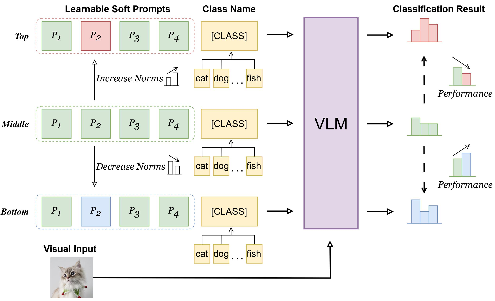
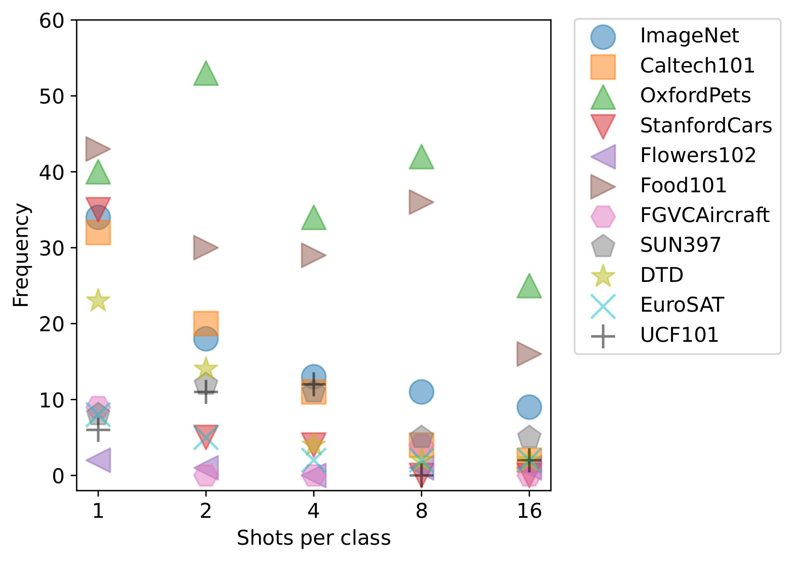
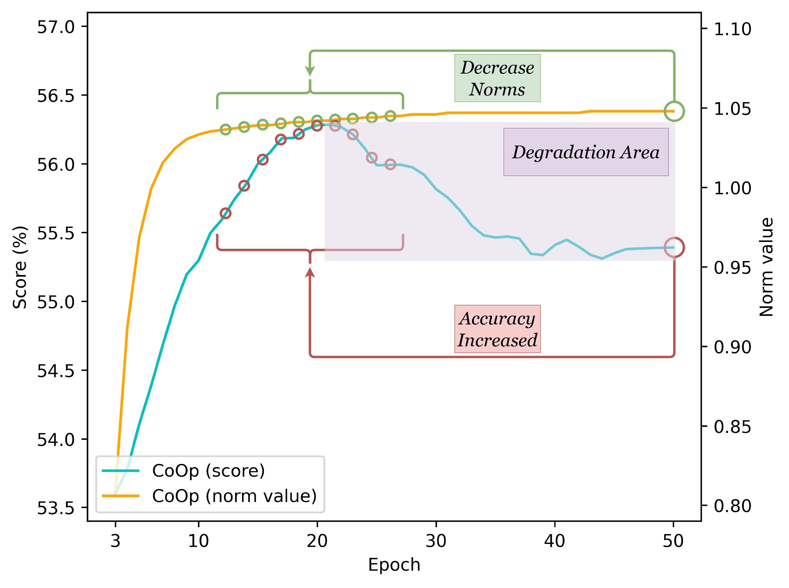
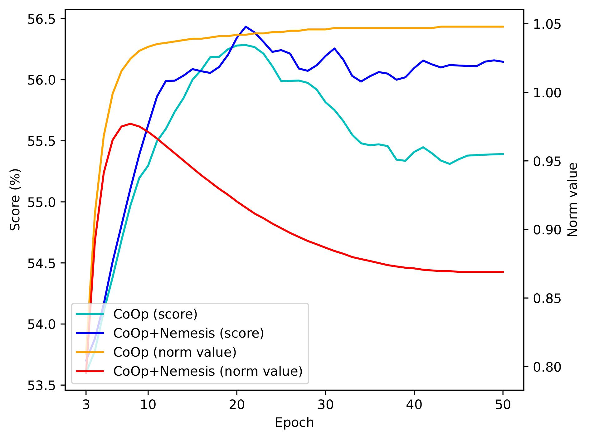
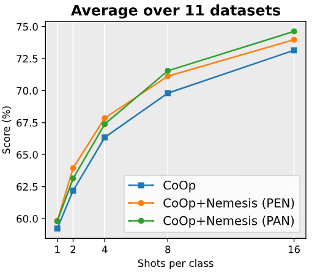
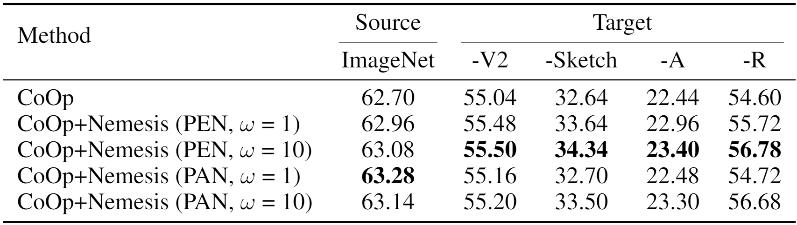
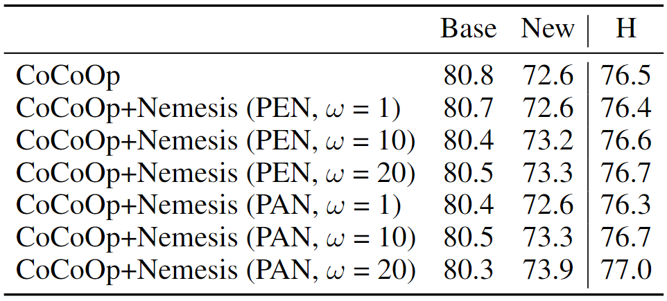

<div align="center">

# ⚖️ Nemesis

### Normalizing the Soft-prompt Vectors of Vision-Language Models

<p>
  <a href="https://arxiv.org/abs/2408.13979"></a>
  <a href="https://openreview.net/forum?id=zmJDzPh1Dm"></a>
  
  
</p>

**Shuai Fu · Xiequn Wang · Qiushi Huang · Yu Zhang**

<p>
  <a href="https://arxiv.org/abs/2408.13979">📄 Paper</a> &nbsp;•&nbsp;
  <a href="#-getting-started">🚀 Getting Started</a> &nbsp;•&nbsp;
  <a href="#-the-low-norm-effect">🔍 The Low-Norm Effect</a> &nbsp;•&nbsp;
  <a href="#-how-nemesis-works">🧩 Method</a>
</p>

</div>

---

> **TL;DR** — We ask a question that soft-prompt tuning had never examined: *do we need to normalize the soft prompts in vision-language models?* Through extensive corruption experiments we uncover the **Low-Norm Effect** — shrinking the norms of certain learned prompt vectors can *improve* a VLM, while growing them usually *hurts* it. To exploit this, we propose **Nemesis**, a plug-in regularizer that normalizes soft-prompt vectors and consistently boosts prompt-tuning methods such as [CoOp](https://github.com/KaiyangZhou/CoOp) and [PLOT](https://github.com/CHENGY12/PLOT).

## 📚 Table of Contents

- [✨ Highlights](#-highlights)
- [🔍 The Low-Norm Effect](#-the-low-norm-effect)
- [🧩 How Nemesis Works](#-how-nemesis-works)
- [📊 Main Results](#-main-results)
- [🚀 Getting Started](#-getting-started)
  - [1. Installation](#1-installation)
  - [2. Datasets](#2-datasets)
  - [3. Corruption Experiments](#3-corruption-experiments)
  - [4. Training with Nemesis](#4-training-with-nemesis)
  - [5. Evaluation](#5-evaluation)
- [🗂️ Repository Structure](#️-repository-structure)
- [📮 Citation](#-citation)
- [🙏 Acknowledgements](#-acknowledgements)
- [📄 License](#-license)

## ✨ Highlights

To answer an unexplored research question — *"Do we need to normalize the soft prompts in VLMs?"* — we first uncover a phenomenon we call the **Low-Norm Effect** through extensive corruption experiments: reducing the norms of certain learned prompts occasionally enhances the performance of VLMs, while increasing them often degrades it.

To harness this effect, we propose **Nemesis** (**N**ormalizing th**e** soft-pro**m**pt v**e**ctors of vi**si**on-language model**s**), a method that normalizes soft-prompt vectors in VLMs. To the best of our knowledge, our work is the first to systematically investigate the role of soft-prompt-vector norms in VLMs, offering valuable insights for future research on soft-prompt tuning.

We further run preliminary experiments confirming that Nemesis generalizes to other **P**arameter-**EF**ficient **T**uning (**PEFT**) methods, including [visual prompt tuning](https://github.com/KMnP/vpt) and [prefix-tuning](https://github.com/XiangLi1999/PrefixTuning). The experiment results verify the effectiveness of Nemesis on these methods. Details found in the [paper](https://arxiv.org/abs/2408.13979) . 

- 🧪 **A new phenomenon** — the *Low-Norm Effect*, characterized across 11 image-classification datasets.
- 🔌 **A plug-and-play regularizer** — Nemesis drops into existing prompt learners (CoOp, PLOT) with a single loss term.
- 📈 **Consistent gains** — improvements on few-shot classification, domain generalization, and base-to-new generalization.
- 🧬 **Beyond text prompts** — early evidence that it transfers to VPT and prefix-tuning.

## 🔍 The Low-Norm Effect

<p align="center">
  
</p>
<p align="center"><em>The schematic diagram of the Low-Norm Effect.</em></p>

Reducing the norms at specific positions within a prompt enhances performance, whereas increasing them typically results in deterioration.

- **Top** — corrupted soft prompts with *increased* norms, leading to *decreased* performance.
- **Middle** — the soft prompts learned by CoOp.
- **Bottom** — corrupted soft prompts with *reduced* norms, resulting in *enhanced* performance.

<p align="center">
  
</p>
<p align="center"><em>The frequency of the Low-Norm Effect across 11 datasets.</em></p>

The 11 datasets exhibit varying frequencies of the Low-Norm Effect. This indicates that tackling the effect is challenging, given its inconsistent manifestation across datasets.

<table align="center">
  <tr>
    <td></td>
    <td></td>
  </tr>
</table>

**Left** — the norms of CoOp's soft prompts first increase and then level off, while test accuracy degrades as the norms flatten out. Corruption operations that *decrease* prompt norms can push the final state away from the degradation area, back toward the low-norm region that demonstrates superior performance.

**Right** — CoOp+Nemesis (ours) shows a distinct norm pattern: an initial increase, a subsequent decrease, and eventual stabilization. Test accuracy trends consistently upward before plateauing, whereas CoOp declines. In other words, Nemesis **delays the point at which soft prompts plateau**, reducing the probability of learning degradation.

## 🧩 How Nemesis Works

Nemesis augments the standard prompt-tuning objective with a **norm-regularization loss** on the learnable context vectors `ctx`. The total objective is:

```
L_total  =  L_CE  +  ω · L_norm
```

where `L_CE` is the usual cross-entropy classification loss and `ω` is a **logistic schedule** (`omega_schedule`) that gradually adjusts the regularization strength over training. `L_norm` combines two complementary terms, balanced by a coefficient `β`:

| Term | Name | What it does |
| :--- | :--- | :--- |
| **PUN** | Position-Uniform Normalization | Applies a uniform norm penalty across *all* prompt positions. |
| **PAN** | Position-Aware Normalization | Probes each position with a corruption operation and penalizes only the positions where reducing the norm *helped* accuracy — directly targeting the Low-Norm Effect. |

`β` selects the regime:

- `β = 1` → **PUN only**
- `β = 0` → **PAN only**
- `0 < β < 1` → `L_norm = β · L_PUN + (1 − β) · L_PAN`

The norm itself (`ℓ₁`, `ℓ₂`, or `ℓ∞`) is configurable via `NT`. This whole mechanism lives in [`trainers/coop_nemesis.py`](trainers/coop_nemesis.py) (for CoOp) and [`trainers/plot_nemesis.py`](trainers/plot_nemesis.py) (for PLOT), while the standalone corruption study lives in [`trainers/coop_crt.py`](trainers/coop_crt.py).

## 📊 Main Results

<p align="center">
  <br>
  <em>Few-shot classification</em>
</p>

<p align="center">
  <br>
  <em>Domain generalization</em>
</p>

<p align="center">
  <br>
  <em>Base-to-new generalization</em>
</p>

## 🚀 Getting Started

### 1. Installation

Nemesis is built on the [Dassl.pytorch](https://github.com/KaiyangZhou/Dassl.pytorch) toolbox. Set up the `dassl` environment first, then install this repo's lightweight extras:

```bash
# 1) Create the Dassl environment (see the Dassl.pytorch repo for full instructions)
git clone https://github.com/KaiyangZhou/Dassl.pytorch.git
cd Dassl.pytorch
conda create -y -n dassl python=3.8
conda activate dassl
pip install -r requirements.txt
python setup.py develop
cd ..

# 2) Clone Nemesis and install its extra dependencies
git clone https://github.com/ShyFoo/Nemesis.git
cd Nemesis
pip install -r requirements.txt
```

### 2. Datasets

Follow [DATASETS.md](./DATASETS.md) to download and organize all 11 classification datasets (plus the 4 ImageNet distribution-shift variants). We recommend keeping them under a single `$DATA` folder as described there.

### 3. Training

Runnable scripts live in [`scripts/`](scripts/), organized by method:

| Directory | Method |
| :--- | :--- |
| [`scripts/coop`](scripts/coop) | CoOp baseline |
| [`scripts/coop_crt`](scripts/coop_crt) | CoOp + corruption (the Low-Norm Effect study) |
| [`scripts/coop_nemesis`](scripts/coop_nemesis) | CoOp + **Nemesis** |
| [`scripts/plot`](scripts/plot) | PLOT baseline |
| [`scripts/plot_nemesis`](scripts/plot_nemesis) | PLOT + **Nemesis** |

> Before running, set the `DATA` path (`/path/to/dataset`) inside each `.sh` file.

For example, to train **CoOp + Nemesis** (arguments: `dataset cfg ctp n_ctx shots csc alpha norm-type n-pos crt-weight beta`):

```bash
CUDA_VISIBLE_DEVICES=0 bash scripts/coop_nemesis/train.sh caltech101 rn50_ep50 end 16 1 False 25 two 1 0.5 0.5
```

The commands for reproducing few-shot learning, domain generalization, and base-to-new tasks follow the same conventions as CoOp — see [COOP.md](COOP.md) for the full argument reference.

### 4. Evaluation

For **distribution-shift robustness**, [`scripts/coop_nemesis/eval.sh`](scripts/coop_nemesis/eval.sh) loads a model trained on ImageNet and evaluates it on the four ImageNet variants (`imagenet_a`, `imagenet_r`, `imagenet_sketch`, `imagenetv2`). Arguments: `trainer dataset alpha norm-type n-pos crt-weight beta`.

```bash
CUDA_VISIBLE_DEVICES=0 bash scripts/coop_nemesis/eval.sh CoOpNemesis imagenetv2 25 two 1 0.5 0.5
```

### 5. Corruption Experiments

To reproduce the Low-Norm Effect study, run corruption evaluations on top of a trained CoOp model (see [`scripts/coop_crt/eval_loop.sh`](scripts/coop_crt/eval_loop.sh)). Arguments: `cfg ctp n_ctx shots csc epoch corrupt-type corrupt-position corrupt-weight`.

```bash
# original (no corruption) — the last two args are placeholders (any value, e.g. 666)
CUDA_VISIBLE_DEVICES=0 bash scripts/coop_crt/eval.sh rn50_ep50 end 16 1 False 50 original 666 666

# replace — inject noise at a given position (corrupt-weight = std of the noise)
CUDA_VISIBLE_DEVICES=0 bash scripts/coop_crt/eval.sh rn50_ep50 end 16 1 False 100 replace 0 0.

# rescale — scale the norm at a given position (corrupt-weight = scaling factor)
CUDA_VISIBLE_DEVICES=0 bash scripts/coop_crt/eval.sh rn50_ep50 end 16 1 False 100 scale 0 0.001
```

> **Note:** the last two arguments are the *corrupt position* and the *corruption weight*. They are unused in `original` evaluation, so any placeholder (e.g. `666`) is fine there.

## 🗂️ Repository Structure

```
Nemesis/
├── train.py              # Entry point: config setup, trainer dispatch, train/eval
├── trainers/             # Prompt-learning trainers
│   ├── coop.py           #   CoOp baseline
│   ├── coop_crt.py       #   Corruption study (the Low-Norm Effect)
│   ├── coop_nemesis.py   #   CoOp + Nemesis  (PUN / PAN normalization losses)
│   ├── plot.py           #   PLOT baseline
│   └── plot_nemesis.py   #   PLOT + Nemesis
├── clip/ , clip_plot/    # Vendored OpenAI CLIP (standard / PLOT variant)
├── datasets/             # 11 datasets + 4 ImageNet distribution-shift variants
├── configs/              # Dataset & trainer YAML configs (backbones, epochs, ...)
├── scripts/              # Ready-to-run training / evaluation bash scripts
├── figures/              # Paper figures used in this README
├── DATASETS.md           # Dataset download & setup guide
└── COOP.md               # CoOp-style argument reference
```

## 📮 Citation

If you find this work useful, please consider citing:

```bibtex
@inproceedings{funemesis,
  title={Nemesis: Normalizing the Soft-prompt Vectors of Vision-Language Models},
  author={Fu, Shuai and Wang, Xiequn and Huang, Qiushi and Zhang, Yu},
  booktitle={The Twelfth International Conference on Learning Representations}
}
```

## 🙏 Acknowledgements

Our code is built on top of [CoOp](https://github.com/KaiyangZhou/CoOp) and [Dassl.pytorch](https://github.com/KaiyangZhou/Dassl.pytorch), and the PLOT experiments follow [PLOT](https://github.com/CHENGY12/PLOT). We thank the authors for releasing their code — please consider citing their work as well.

## 📄 License

This project is released under the [MIT License](./LICENSE).
